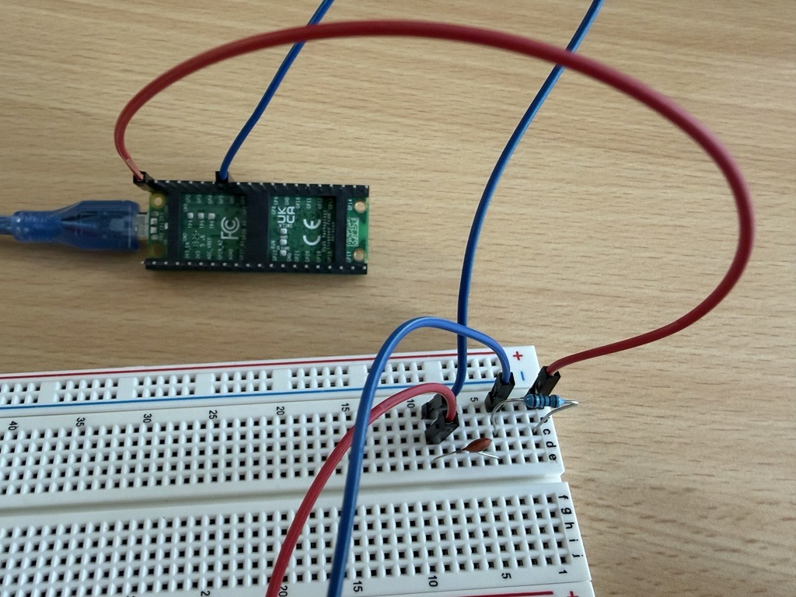
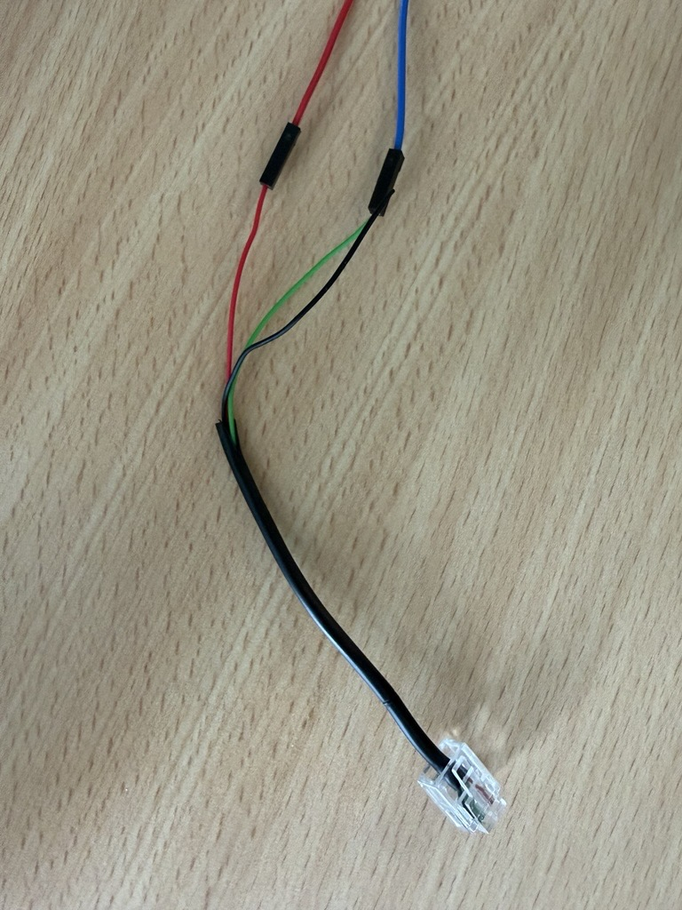
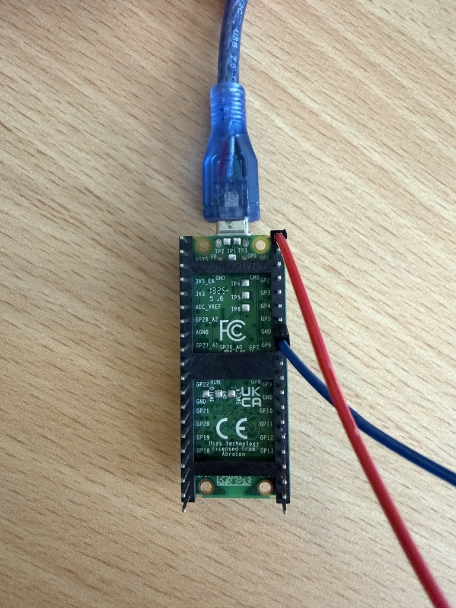
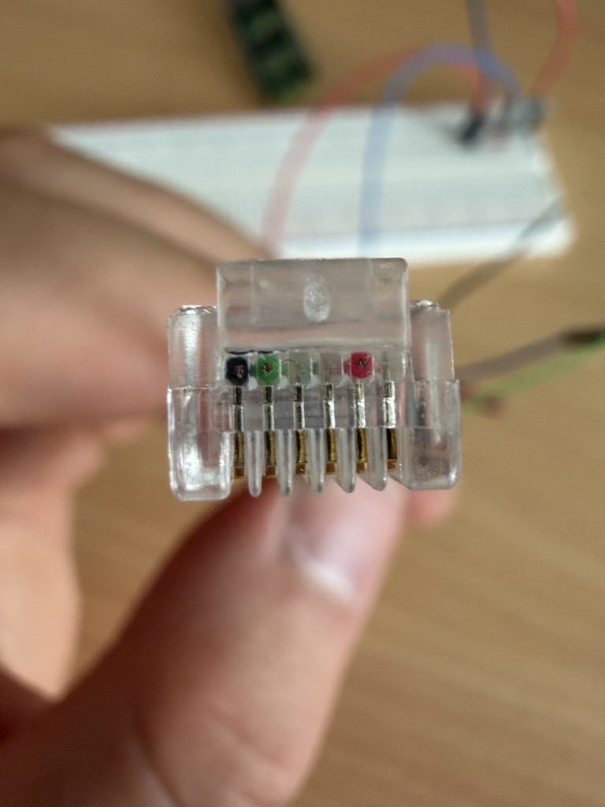

# Pico-Firmware

Dieser Ordner enthält die MicroPython-Firmware, die auf dem Raspberry Pi Pico
als `main.py` gespeichert wird.

## Aufgabe

Der Pico emuliert das Gas-Signal des Carrera-Handreglers:

```text
Laptop -> USB-Serial -> Pico GP0 PWM -> RC-Glied -> Carrera Control Unit
```

Die Firmware steuert keinen Motor und keinen mechanischen Slider. Sie erzeugt
 direkt das PWM-Signal für die CU.

## Hardware

- Pico `GP0`: PWM-Ausgang
- PWM-Frequenz: `100 kHz`
- maximale PWM-Ausgabe: `40 % Duty Cycle`
- RC-Glied: `2 kOhm` in Reihe und `100 nF` gegen Masse
- CU-Gassignal: RJ11 Pin 5
- gemeinsame Masse: RJ11 Pin 2
- CU-Auflösung: 16 Stufen von `0` bis `15`
- unterhalb Stufe `4` startet das Fahrzeug normalerweise nicht

## Bilder zum Aufbau









## Firmware

Die Datei [main.py](main.py) verwendet:

```python
pwm = PWM(Pin(0))
pwm.freq(100_000)
MAX = 0.4
TIMEOUT_MS = 500
```

Sie erwartet pro Zeile eine einzelne Ganzzahl:

```text
8
```

Die Eingabe wird auf `0..15` begrenzt. Eine gültige Eingabe wird als Bestätigung
zurückgesendet:

```text
8
```

## Watchdog

Kommt 500 ms lang kein gültiger neuer Befehl vom Laptop, setzt der Pico die
PWM automatisch auf Stufe `0`. Dieser Watchdog ist unabhängig davon, ob der
Laptop-Prozess abstürzt oder die USB-Verbindung abbricht.

Der Laptop-Regelkreis muss deshalb regelmäßig senden. Der schnelle Pfad dafür
ist `CarreraCuController.set_stage_fast(...)`.

## Firmware aufspielen

Aus dem Projektordner `carrera_project`, wenn der Pico an `COM4` angeschlossen ist:

```powershell
python -m pip install mpremote
python -m mpremote connect COM4 fs cp pico\main.py :main.py + reset
```

Prüfen, ob der Pico erkannt wird:

```powershell
python -m mpremote devs
```

Thonny oder ein anderer serieller Monitor darf COM4 während des Uploads und
des Laptop-Tests nicht geöffnet haben.

## Laptop-Protokolltest

```powershell
@'
from carrera_control.cu_controller import CarreraCuController

with CarreraCuController(port="COM4") as controller:
    print(controller.set_stage(4))
    print(controller.set_stage(5))
'@ | python
```

Beim Verlassen des `with`-Blocks wird Stufe `0` gesendet.
